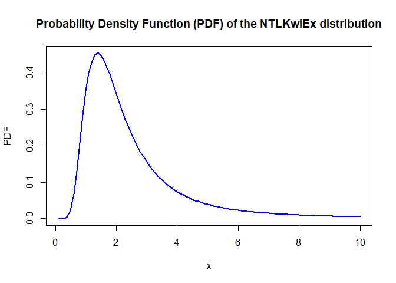
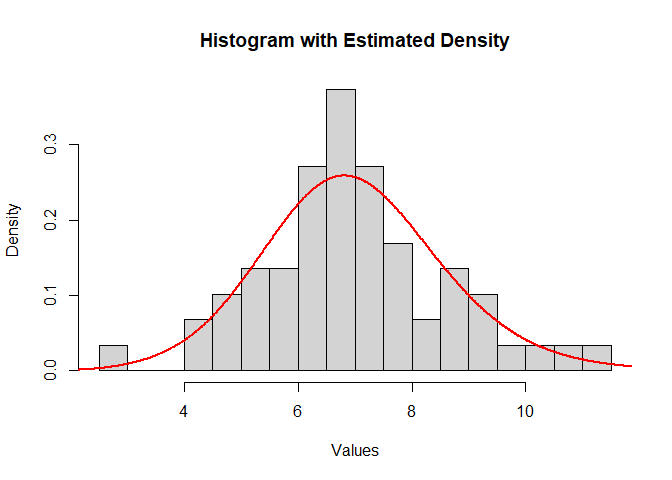

<!-- README.md is generated from README.Rmd. Please edit that file -->

# NTLKwIEx

<!-- badges: start -->

[](https://CRAN.R-project.org/package=NTLKwIEx)
[](https://CRAN.R-project.org/package=NTLKwIEx)
[](https://www.gnu.org/licenses/old-licenses/gpl-2.0.html)
<!-- badges: end -->

**NTLKwIEx** provides statistical tools for the *New Topp-Leone
Kumaraswamy Inverse Exponential* (NTLKwIEx) distribution, a flexible
five-parameter lifetime distribution. The package lets you:

- evaluate the density, the cumulative distribution function and the
  quantiles;
- simulate random samples;
- estimate the parameters by maximum likelihood;
- plot the theoretical curves and compare a fitted density with your
  data.

## The distribution

With $K(x) = e^{-\theta/x}$ for $x > 0$, the cumulative distribution
function is

$$F(x;\theta,\alpha,a,b,m) = \left[\,1-\left(1-K(x)^{\,a\,\alpha^{K(x)}}\right)^{2b}\right]^{m},
\qquad \theta,\ \alpha,\ a,\ b,\ m > 0 .$$

The theory, the properties and applications of the distribution are
presented in the articles listed in the [References](#references)
section.

## Installation

Install the released version from CRAN:

``` r
install.packages("NTLKwIEx")
```

Or the development version from GitHub:

``` r
# install.packages("pak")
pak::pak("Otodji/NTLKwIEx")
```

## Functions

| Function | Purpose |
|:---|:---|
| `P_NTLKwIEx(x, teta, alpha, a, b, m)` | Probability density function |
| `C_NTLKwIEx(x, teta, alpha, a, b, m)` | Cumulative distribution function |
| `Q_NTLKwIEx(p, teta, alpha, a, b, m)` | Quantile for a probability `p` |
| `R_NTLKwIEx(n, teta, alpha, a, b, m)` | Random sample of size `n` |
| `E_NTLKwIEx(data)` | Maximum likelihood estimation of the five parameters |
| `Sim_NTLKwIEx(data)` | Histogram of the data with the fitted density overlaid |
| `Plot_PNTLKwIEx(teta, alpha, a, b, m, min_x, max_x)` | Plot of the density |
| `Plot_CNTLKwIEx(teta, alpha, a, b, m, min_x, max_x)` | Plot of the cumulative distribution function |

The package also ships the dataset `ConductorFailureTimes`: failure
times (in hours) of 59 conductors from an accelerated life test.

## Examples

``` r
library(NTLKwIEx)
```

### Density, distribution function and quantiles

``` r
# Density and cumulative probability at x = 2
P_NTLKwIEx(2, teta = 2, alpha = 0.5, a = 1, b = 1, m = 2)
#> [1] 0.3427294
C_NTLKwIEx(2, teta = 2, alpha = 0.5, a = 1, b = 1, m = 2)
#> [1] 0.5029632

# Median of the distribution
Q_NTLKwIEx(0.5, teta = 2, alpha = 0.5, a = 1, b = 1, m = 2)
#> [1] 1.99138
```

### Random samples

``` r
set.seed(123)
R_NTLKwIEx(5, teta = 2, alpha = 0.5, a = 1, b = 1, m = 2)
#> [1] 1.466277 3.349205 1.748319 4.542187 6.319556
```

### Plotting the density

``` r
Plot_PNTLKwIEx(teta = 2, alpha = 0.5, a = 1, b = 1, m = 2,
               min_x = 0.1, max_x = 10)
```



### Fitting the distribution to data

`E_NTLKwIEx()` returns the maximum likelihood estimates in the order
`teta`, `alpha`, `a`, `b`, `m`.

``` r
data(ConductorFailureTimes)

estimates <- E_NTLKwIEx(ConductorFailureTimes)
setNames(estimates, c("teta", "alpha", "a", "b", "m"))
#>         teta        alpha            a            b            m 
#> 2.078874e+01 1.213560e-06 1.108665e+00 1.446496e+00 8.543094e-01
```

`Sim_NTLKwIEx()` draws the histogram of the data and overlays the fitted
density:

``` r
Sim_NTLKwIEx(ConductorFailureTimes)
```



## References

If you use this package, please cite the articles that introduce the
distribution:

- Atchadé, M. N., Otodji, T., & Djibril, A. (2024).
  <https://doi.org/10.1063/5.0179458>
- Atchadé, M. N., Otodji, T., Djibril, A., & N’bouké, M. (2023).
  <https://doi.org/10.1515/phys-2023-0151>

The citation of the package itself is given by:

``` r
citation("NTLKwIEx")
```

## Authors

- Mintodê Nicodème Atchadé
- Théophile Otodji (maintainer) — [ORCID
  0009-0003-0389-9007](https://orcid.org/0009-0003-0389-9007)

## Bug reports

Please report bugs and suggestions on the [issue
tracker](https://github.com/Otodji/NTLKwIEx/issues).

## License

GPL-2
